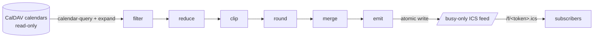

# Milchglas

> Frosted glass for your calendar: others see *that* you are busy — never *what* you are doing.

[](https://github.com/Prism-Purpose-Pace/milchglas/actions/workflows/ci.yml)
[](https://github.com/Prism-Purpose-Pace/milchglas/actions/workflows/codeql.yml)
[](https://scorecard.dev/viewer/?uri=github.com/Prism-Purpose-Pace/milchglas)
[](pyproject.toml)

[](docs/threat-model.md)
[](docs/architecture.md)

[](https://github.com/Prism-Purpose-Pace/milchglas/releases)
[](pyproject.toml)
[](LICENSE)
[](https://github.com/astral-sh/ruff)
[](https://github.com/astral-sh/uv)
[](https://mypy-lang.org/)

Milchglas (German for *frosted glass*) reads private CalDAV calendars — for example on
Nextcloud — strictly read-only, reduces every event to an anonymous time block and
publishes one busy-only ICS feed. Subscribe to that feed wherever your availability
matters — a work calendar, a booking tool — without handing it a single title,
location or attendee.

> [!IMPORTANT]
> **Status: pre-alpha.** The specification, the toolchain, the pure pipeline core, the
> configuration loader, the token commands and the web surface are in place; the CalDAV
> fetch and the refresh are being built. Do not use it in production yet. Progress: [docs/spec.md](docs/spec.md).

## Why

Calendar sharing is access control, not redaction. Once a consumer may read a calendar it
sees everything, and "private" flags are honoured inconsistently across servers and
clients. Milchglas does the redaction itself, before anything leaves your server, and
never writes to a source calendar.

## How it works



- **Filter** drops cancelled events, events marked free (`TRANSP:TRANSPARENT`) and
  invitations you declined.
- **Reduce** keeps only start, end, tentative and all-day — immediately after parsing.
- **Clip, round, merge** limit the feed to a time window, round to a 15-minute grid in
  local time and merge overlapping and adjacent blocks.
- **Emit** writes minimal events (`UID`, `DTSTAMP`, `DTSTART`, `DTEND`, `SUMMARY`,
  `TRANSP`, `STATUS`) in UTC. Output is deterministic: an unchanged source yields a
  byte-identical feed, so subscribers never see duplicates.
- **Fail-safe:** if a source is unreachable, the last good feed stays in place; an
  outage never produces an empty feed.

## Target consumers

| Consumer | Integration |
|---|---|
| OX App Suite (e.g. mailbox.org) | iCal feed subscription as a second calendar |
| meetergo | read-only ICS calendar for conflict checks |
| Any RFC 5545 client | subscribe to the feed URL |

Compatibility is being verified; the open items are tracked in
[docs/spec.md §11](docs/spec.md#11-verification-plan-for-assumptions).

## Configuration (planned)

Non-secret settings live in one `config.json` and take effect on the next refresh:

| Key | Default | Meaning |
|---|---|---|
| `tz` | `Europe/Berlin` | time zone for grid rounding |
| `window_days` | `33` | feed horizon from today |
| `grid_minutes` | `15` | rounding grid |
| `summary` | `Blocker Privat` | title of every busy block |
| `ttl_seconds` | `900` | refresh interval hint |
| `allday_mode`, `tentative_mode` | see spec | how all-day and tentative events are shown |
| `owner_emails` | — | addresses whose declined invitations are skipped |
| `calendars[]` | — | `{href, name, enabled}` per source calendar |
| `token_sha256` | — | SHA-256 of the feed token, printed by `init` and `rotate-token` |
| `uid_salt` | — | salt of the block UIDs, printed once by `init` |

Secrets and paths come only from the environment: `CALDAV_URL` (DAV root),
`CALDAV_USER`, `CALDAV_SECRET` (an app password with read access), `MILCHGLAS_VAR_DIR`
(feed, state and run lock), `MILCHGLAS_CONFIG` (path to `config.json`, default
`./config.json`), `MILCHGLAS_LOG_LEVEL`.

## Deployment (planned)

One host-independent Python core, several ways to run it
([docs/spec.md §9](docs/spec.md#9-deployment-options)): **B** Docker containers
(`web` + `refresher`, the default), **A** systemd on a VPS, **C** shared Python web
hosting, **D** a PHP port that must produce byte-identical feeds.

## Development

```bash
uv sync
uv run pytest
pre-commit install --install-hooks
```

Everything else — gates, conventions, the privacy rules for contributions — is in
[CONTRIBUTING.md](CONTRIBUTING.md) and [TOOLING.md](TOOLING.md).

## Security

The feed URL contains a secret token; treat it like a password. Wrong tokens and unknown
paths get an identical `404`. Please report vulnerabilities privately — see
[SECURITY.md](SECURITY.md).

## License

[MIT](LICENSE) © 2026 Philipp Sieder
