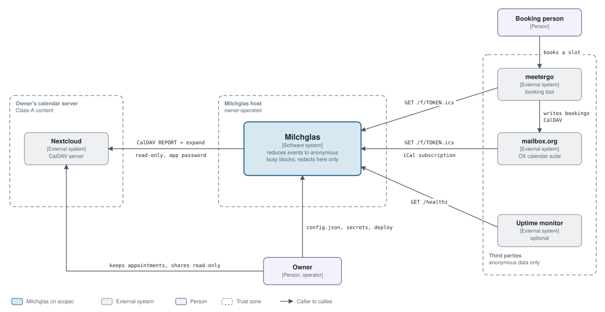
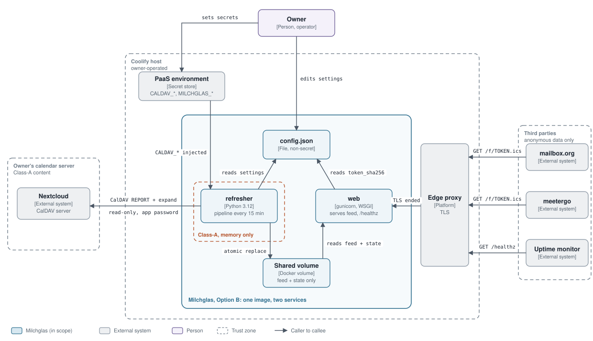

# Milchglas - Architecture

Milchglas reads private CalDAV calendars read-only, reduces every event to an anonymous time
interval and publishes the result as a busy-only ICS feed. A calendar suite and a booking tool
subscribe to that feed, so the owner sees "busy" blocks and the booking tool avoids colliding
slots, while titles, descriptions, locations and attendees never leave the source system. Per
event only start, end and two flags survive the reduction; the rest exists in memory for the
moment of parsing and is then discarded (spec G1, G3, FR-4).

This page shows the MVP architecture in two C4 views: the system in its environment, and the
containers of the default deployment, Option B. Milchglas is pre-feature: the diagrams describe
the planned MVP, not shipped code. Every statement traces to [spec.md](spec.md) (cited as
section, requirement or decision ID) or to the layout and invariants in `CLAUDE.md`.

**Legend.** Blue = Milchglas (the system in scope; in the container view its system boundary is
the solid outline); grey = external system; violet = person. A dashed region is a trust zone:
every arrow that crosses one crosses a trust boundary. The orange dashed region marks the only
place where event content (Class-A) exists, in the refresher's memory. An arrow starts at the
caller; its label gives the protocol. `TOKEN` stands for the capability token in the feed URL
(spec NFR-S1). Data about events flows the opposite way to the consumer arrows: consumers pull,
Milchglas never pushes (spec W1). The diagrams are SVG files in `docs/diagrams/`.

---

## 1. System Context

Nextcloud is deliberately not connected to meetergo: the booking tool only ever sees the
anonymous feed (spec D-4). Nextcloud sharing is used for least privilege, never for redaction
(spec D-3).

### 1.1 Elements

| Name | Type | Responsibility | Spec reference |
|---|---|---|---|
| Calendar owner and maintainer | Person | Owns the private appointments, shares the calendars read-only with a dedicated service user, edits the config file, sets secrets in the platform, and is the only operator (one person, no on-call). | section 1; G6, G7; D-2; W3 (no multi-user) |
| Person booking an appointment | Person | Books a slot through the booking tool; never interacts with Milchglas and never sees private content. | section 1 (problem 2); AC-11 |
| Milchglas | System | Fetches the enabled calendars, reduces each event to `(start, end, tentative, allday)`, clips, rounds, merges, emits one ICS feed and serves it by capability URL. Redaction happens only here. | section 1; G1, G3, G9; D-1, D-3; section 8 |
| Nextcloud | External system (CalDAV server) | Source of truth for private calendars. Exposes them read-only to the service user. Not trusted for redaction. | section 1; section 4.1; D-2, D-3; NFR-S3 |
| mailbox.org | External system (Open-Xchange suite) | Consumer. Subscribes to the feed as a second calendar of anonymous blocks, and holds the business calendars into which bookings are written. | section 1; section 4.2; G2; D-4; AC-0.1 |
| meetergo | External system (booking tool) | Consumer. Reads the feed as a read-only ICS calendar for conflict checks and writes bookings to the business calendar. | section 1; section 4.3; G2; D-4; AC-0.2, AC-11 |
| Uptime monitor | External system (optional) | Polls `/healthz` so staleness is noticed before a consumer does. | NFR-R2; FR-11; section 9 (Option B, maintenance) |

### 1.2 Relationships

| # | From | To | Purpose and direction | Protocol | Spec reference |
|---|---|---|---|---|---|
| 1 | Owner | Nextcloud | Owner creates private events and shares calendars read-only with the service user. | Nextcloud Calendar | D-2; NFR-S3 |
| 2 | Owner | Milchglas | Maintenance: edit `config.json`, set environment secrets, deploy by Git push. Never through a UI that shows secrets. | PaaS terminal or mounted file | G7; FR-12; D-11; section 9 (Option B, maintenance) |
| 3 | Owner | mailbox.org | Owner reads the busy blocks in the subscribed calendar. | OX web client | section 1 (problem 1); AC-11 |
| 4 | Person booking | meetergo | Books a slot; meetergo hides slots that collide with a block. | HTTPS, booking page | section 1 (problem 2); AC-0.2 |
| 5 | Milchglas | Nextcloud | Pull. Reads all enabled calendars of the service user; server-side recurrence expansion; 10 s timeout, 3 retries. | CalDAV `REPORT calendar-query` with `expand`, HTTPS, Basic auth, read-only | FR-1, FR-2; section 4.6; NFR-S3 |
| 6 | mailbox.org | Milchglas | Pull. Periodic fetch of the feed; the feed's `REFRESH-INTERVAL` is honoured. | HTTPS `GET /f/<token>.ics`, iCal subscription | FR-7, FR-9; section 4.2; V-1 |
| 7 | meetergo | Milchglas | Pull. Periodic fetch of the feed; the URL must be publicly reachable. | HTTPS `GET /f/<token>.ics`, ICS calendar | FR-9; section 4.3; V-5 |
| 8 | meetergo | mailbox.org | Bookings continue to flow into the business calendar. Unchanged by Milchglas. | CalDAV | section 1; W1; section 8 |
| 9 | Uptime monitor | Milchglas | Pull. 200 if the last success is younger than 60 minutes, else 503, no body data. | HTTPS `GET /healthz` | FR-11; NFR-R2; AC-7 |

---

## 2. Containers (Option B, default)

Option B is the recommended target: one image, two Compose services on a self-hosted PaaS
(for example Coolify), TLS from the platform's edge proxy (spec section 9, Option B; D-9
recommendation in 9.2). Option A reuses the same containers (see the Option A part below).

As drawn, the `refresher` is the only container with an outbound edge to the CalDAV server, and
`web` reads only the reduced feed. The spec also names a lazy refresh in `web` as a safety net
for Option B (spec section 9, Option B, scheduling). It is not drawn because the spec defines no
interface for it. If built, it runs the same refresh code path: `web` would then also need the
CalDAV variables and would hold event content in memory during that run, under the same
invariants (no persistence, no logging).

### 2.1 Elements

| Name | Type | Responsibility | Spec reference |
|---|---|---|---|
| web | Container (Python 3.12, gunicorn, WSGI) | Serves `/f/<token>.ics` with `200 text/calendar; charset=utf-8`, `ETag`, `X-Robots-Tag: noindex`, `Referrer-Policy: no-referrer`; a wrong token and any unknown path return the identical 404 (constant-time token compare); serves `/healthz` (200 if last success under 60 min, else 503, no other data). Runs unprivileged. | FR-9, FR-11; NFR-S1, NFR-S4; AC-9, AC-7; Q-17; section 8 (layout: `web/`) |
| refresher | Container (Python 3.12, `python -m milchglas refresh --loop --interval 900`) | Runs the one-directional pipeline every 15 minutes: fetch, filter, reduce, clip, round, merge, emit, atomic write. Holds event content in memory only and reduces each event immediately. A single `python -m milchglas refresh` is idempotent and safe by hand. Finishes the current write on SIGTERM. | FR-1 to FR-8, FR-10; NFR-P1, NFR-O1; D-7; section 8 (pipeline); section 9 (Option B); `CLAUDE.md` (invariants) |
| Shared volume | Container database (volume at `MILCHGLAS_VAR_DIR`) | Holds the published feed file (anonymous intervals) and the state (last success, last error). Previous feed survives any failed refresh. The only state of the system; migrating a host is a volume copy. | FR-8, FR-11; NFR-R1, NFR-O1; D-7d; section 9 (Option B); section 8 (`state.py`) |
| config.json | Container database (JSON file) | Non-secret configuration; the keys are listed once, in [spec section 8](spec.md#8-solution-concept-host-independent-core) (`config.json`). It holds the SHA-256 of the feed token (`token_sha256`), never the token itself (D-14). Lives on the volume or as a mounted file. Edits apply on the next refresh. | section 8 (config); D-14; FR-12; AC-10; section 9 (Option B, maintenance) |
| PaaS environment variables | External system | Only channel for secrets and paths: `CALDAV_URL`, `CALDAV_USER`, `CALDAV_SECRET`, `MILCHGLAS_VAR_DIR`, `MILCHGLAS_LOG_LEVEL`. Never in the image, Git, `config.json` or any UI. | D-11; NFR-S2; AC-13; section 8 (environment) |
| Edge proxy | External system (Traefik or the PaaS built-in proxy) | Routes an operator-chosen subdomain to `web` and provides TLS. Access logs must not carry the feed path with the token (strip or hash here). | section 9 (Option B); V-8; NFR-S1, NFR-S5; Q-6 |
| Calendar owner and maintainer | Person | Edits `config.json` and sets secrets; forces a refresh by running the command by hand. | G7; FR-12; NFR-O1; section 9 (Option B, maintenance) |
| Nextcloud | External system | Serves calendars read-only to the service user. | FR-1; D-2; NFR-S3 |
| mailbox.org | External system | Subscribes to the feed. | G2; D-4 |
| meetergo | External system | Reads the feed for conflict checks. | G2; D-4 |
| Uptime monitor | External system (optional) | Polls `/healthz`. | NFR-R2; FR-11 |

### 2.2 Relationships

| # | From | To | Purpose and direction | Protocol | Spec reference |
|---|---|---|---|---|---|
| 1 | mailbox.org | Edge proxy | Pull of the feed. | HTTPS `GET /f/<token>.ics` | FR-9; V-1 |
| 2 | meetergo | Edge proxy | Pull of the feed. | HTTPS `GET /f/<token>.ics` | FR-9; V-5 |
| 3 | Uptime monitor | Edge proxy | Pull of `/healthz`. | HTTPS `GET /healthz` | FR-11; NFR-R2 |
| 4 | Edge proxy | web | Forwards each request after TLS termination. | Reverse proxy | section 9 (Option B); V-8 |
| 5 | web | Shared volume | Reads the feed file it serves and the state it reports on `/healthz`. | File read | FR-9, FR-11 |
| 6 | web | config.json | Reads the feed token to compare against the request path. | JSON read | FR-9; section 8 (config) |
| 7 | refresher | config.json | Reads settings at the start of every run, so edits need no restart. | JSON read | AC-10; section 8 (config) |
| 8 | refresher | Nextcloud | Pull. Reads enabled calendars; server-side `expand`; event content in memory only. | CalDAV `REPORT calendar-query`, HTTPS, Basic auth, read-only | FR-1, FR-2; NFR-S3; NFR-S4 |
| 9 | refresher | Shared volume | Atomic replace of the feed on full success; on any error the old file stays and the error goes into state. | Atomic file replace | FR-8; D-7d; NFR-R1; AC-7 |
| 10 | PaaS environment | refresher | Injects the five variables once at startup. | Environment variables | D-11; NFR-S2 |
| 11 | PaaS environment | web | Injects `MILCHGLAS_VAR_DIR` and `MILCHGLAS_LOG_LEVEL`. | Environment variables | D-11; section 8 (environment) |
| 12 | Owner | config.json | Edits settings (enable or disable a calendar, rotate the token). | PaaS terminal or mounted file | FR-12; G7; AC-10 |
| 13 | Owner | PaaS environment | Sets or rotates the secrets. | PaaS settings | D-11; NFR-S2 |

### 2.3 Data flow and privacy boundary

The data path is one-directional; nothing flows back from the volume or from `web` into the
Nextcloud side.

1. `refresher` reads `config.json` and its environment.
2. It fetches the enabled calendars from Nextcloud with `calendar-query` and `expand` (FR-1, FR-2).
3. In memory it drops excluded events, reduces each event to `(start, end, tentative, allday)`,
   clips to the window, rounds to the grid and merges overlapping and adjacent intervals
   (FR-3 to FR-6). From the reduce step on, no private field exists anywhere.
4. It emits the ICS feed with deterministic UIDs (FR-7; D-7).
5. It replaces the feed file on the volume atomically, only after full success; on any error the
   previous file stays and the error is recorded in state (FR-8; D-7d).
6. `web` serves the file through the edge proxy to the consumers, and reports health from state.

What keeps event content inside the `refresher`:

- Titles, descriptions, locations and attendees never reach disk, logs, metrics or exception
  messages (NFR-P1). Tests grep the feed and every log line for fixture titles (AC-8).
- The feed carries only `UID, DTSTAMP, DTSTART, DTEND, SUMMARY, TRANSP, STATUS` and an optional
  Microsoft busy hint (NFR-P3).
- `config.json` and the image hold no secret; the CalDAV secret exists only in the environment
  (D-11, NFR-S2, AC-13).
- As drawn, the only outbound connection is `refresher` to the CalDAV host (NFR-S4); `web` has none.

---

## 3. Option A: the same containers as systemd units

Option A (spec section 9, Option A) keeps the code and the pipeline and changes only the
packaging. The Python package runs from a virtual environment on a Linux VM. `refresher` becomes a
systemd service plus a 15-minute timer (or a `--loop` daemon), started by hand with
`systemctl start milchglas-refresh`. The shared volume becomes a directory such as
`/srv/milchglas`, with the feed under `/srv/milchglas/feed/<token>.ics`. The PaaS environment
variables become an `EnvironmentFile` (`0600`, root-owned). The edge proxy becomes Caddy with
automatic TLS or the VM's existing reverse proxy, and `web` is optional: the proxy can serve the
feed file as a static file (spec section 8, layout note). The unit files live in
`deploy/vps-systemd/` (spec 9.2, item 2) and add systemd hardening (`DynamicUser`,
`ProtectSystem=strict`, `ReadWritePaths`, an egress IP allow-list, `PrivateTmp`,
`NoNewPrivileges`), the strongest security posture of the options. The context view and the data
flow in 2.3 stay unchanged.

---

## 4. Out of scope of these diagrams

- **Backlog (spec section 12), not drawn:** admin UI (FR-17, FR-18), per-consumer tokens
  (FR-16), fail-closed blockers (FR-15), `free-busy-query` acquisition (FR-19), CalDAV push into
  the consumer calendar (FR-20), all-day and tentative modes beyond `busy` (FR-13, FR-14). Each
  needs an explicit maintainer decision before it is built.
- **Options C and D (spec section 9):** shared-hosting variants. Option C serves the same WSGI app
  under Passenger and makes the admin UI mandatory; Option D is a separate PHP codebase that must
  produce byte-identical feeds from the same golden fixtures. Neither is part of the default
  architecture.
- **Open questions (spec section 13)** keep their stated defaults and stay configurable; they do
  not change the structure shown here.
