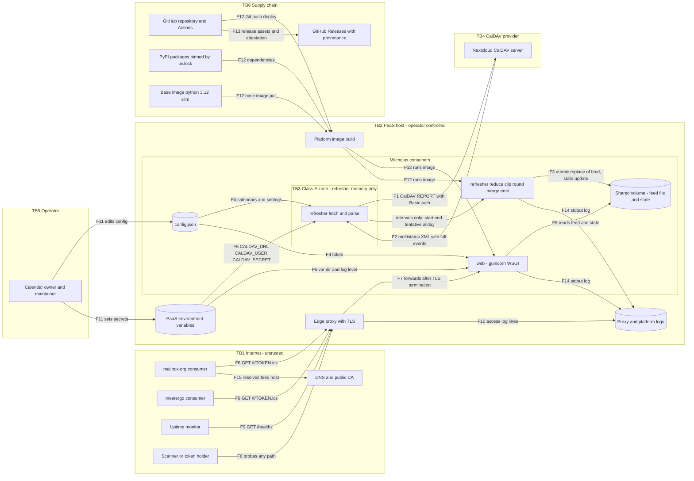

# Milchglas - Threat model

Milchglas reads private CalDAV calendars read-only, reduces every event to an anonymous
interval and publishes a busy-only ICS feed (see [architecture.md](architecture.md)). This page
models the threats to the **planned MVP**: Milchglas is pre-feature, so every statement refers
to the design in [spec.md](spec.md) (cited by requirement, decision, acceptance-criterion or
open-question ID, or by section), to the invariants in `CLAUDE.md`, and to the repository's CI
and release setup in `TOOLING.md`, `SECURITY.md` and `.github/workflows/`.

- **Deployment modelled:** Option B (two Compose services on a self-hosted PaaS, spec section 9),
  with the deltas of Option A (systemd units on a VM) where they change a threat. Options C and D
  and the backlog (spec section 12, FR-15 to FR-20, NFR-S6) are out of scope; each needs its own
  pass when it is pulled forward, the admin UI above all.
- **Method:** scope and assets (section 1), trust boundaries and a data-flow diagram
  (section 2), STRIDE per element and per data flow (section 3), a privacy pass with the LINDDUN
  categories linking, identifying, detecting and data disclosure (section 4), summary and
  proposed spec changes (section 5), evidence (section 6).
- **Date of analysis:** 2026-10-21. Factual claims carry an evidence ID (E-n, section 6) with
  source and verdict.

**Scoring.** Likelihood (L) and impact (I) take L = 1, M = 2, H = 3. Risk = L x I:
**High** 6 to 9, **Medium** 3 to 4, **Low** 1 to 2.

- Impact **H**: Class-A content or the CalDAV credential is disclosed, or the feed reaching the
  consumers is wrong or empty (double bookings).
- Impact **M**: the busy pattern or the feed token reaches a third party, or the feed is stale
  or unavailable for hours.
- Impact **L**: fingerprinting, metadata about the service, nuisance.
- Likelihood **H**: happens by construction or routinely; **M**: plausible without a skilled
  attacker (operator mistake, real-world data quirk, common platform default); **L**: needs a
  skilled attacker, a second failure or a compromised provider.

**Gap.** *none* = the existing mitigation covers the threat (a test may still be missing);
*partial* = a mitigation exists but leaves a stated hole; *open* = nothing in the spec covers it.
Every proposed control is written as the check that fails when the control is missing.

---

## 1. Scope, assets and security objectives

### 1.1 Assets

| ID | Asset | Where it lives | Objective | Spec anchor |
|---|---|---|---|---|
| A1 | **Class-A event content**: titles, descriptions, locations, attendees | CalDAV server; refresher memory during one run | Confidentiality: never on disk, in logs, metrics, exception messages or HTTP responses of Milchglas | G1, G3, FR-4, NFR-P1, AC-8; spec section 15 |
| A2 | **Busy pattern**: the set of anonymous intervals; personal data even without content (presence, absence, routine) | Feed file, consumers, anyone holding the feed URL | Minimisation and confidentiality toward everyone except the two consumers | G9, NFR-P2, NFR-P3; spec section 15 |
| A3 | **CalDAV credential**: service-user name and app password | Platform environment; refresher process | Confidentiality; least privilege when lost | D-2, D-11, NFR-S2, NFR-S3, AC-13 |
| A4 | **Feed capability token** | `config.json`; consumers; request path | Confidentiality, entropy, revocability | NFR-S1, NFR-S5, FR-9, FR-16 (LATER) |
| A5 | **Feed integrity and availability**: correct blocks, reachable feed | Shared volume, `web`, consumers' caches | A wrong, stale or empty feed causes double bookings; a full one blocks all bookings | G4, G5, D-7, FR-8, NFR-R1, AC-1 to AC-7 |
| A6 | **Configuration integrity**: calendar hrefs, owner e-mails, `tz`, window, grid, UID salt | `config.json` | Only the operator changes it; invalid values never reach the feed | FR-12, AC-10, Q-13 |
| A7 | **Release artefacts, CI and the deploy path** | GitHub repository and Actions; release assets; the platform build | The code that runs is the code that was reviewed and attested | AC-12, AC-13; `TOOLING.md`; `SECURITY.md` |

### 1.2 Threat actors

| Actor | Capability | Typical goal |
|---|---|---|
| Internet scanner | Any HTTP request to the feed host | Find the feed, fingerprint the service |
| Holder of a leaked feed URL | Unlimited `GET` of the feed | Follow the owner's presence over time |
| Hostile or compromised CalDAV server, or a network attacker on that path | Arbitrary responses to the refresher | Crash or stall the refresher, steal the credential, forge the feed |
| Anyone who can put events into an enabled calendar | Calendar invitations, write access to a shared calendar | Block or free booking slots |
| Co-tenant or compromised app on the same platform | Platform network, possibly the Docker socket | Reach `web` past the proxy, read the environment |
| Supply-chain attacker | A dependency release, an action tag, a base-image tag | Run code next to Class-A content and the credential |
| The two consumers | Legitimate feed access | None hostile; their staff and breaches are a disclosure route |
| The operator (no malice) | Edits `config.json`, sets secrets, deploys, troubleshoots | Mistakes: empty feed, leaked token, debug dumps |

### 1.3 Out of scope

Protection against the providers themselves (CalDAV host, platform, consumers) processing what
they legitimately see (spec W6), compromise of the CalDAV server or of the host Milchglas
runs on (`SECURITY.md`, out of scope), how consumers cache or display the feed (`SECURITY.md`),
and encryption of the feed for consumers (spec W5). These still appear as residual risks
in section 5.3 where they bound what Milchglas can promise.

---

## 2. Trust boundaries and data flow

### 2.1 Trust boundaries

| ID | Boundary | What crosses it | Why it matters |
|---|---|---|---|
| TB1 | Internet to edge proxy | Consumer polls, monitor checks, scanner probes | Every request is untrusted; the token is the only credential (NFR-S1) |
| TB2 | Edge proxy and platform network to the Milchglas containers | Forwarded requests after TLS termination | Co-tenant apps share the platform network; access logs are written here (NFR-S5) |
| TB3 | Class-A zone inside the refresher | Full events in, `(start, end, tentative, allday)` out | The privacy boundary of `architecture.md` section 2.3: from the reduce step on, no private field exists (FR-4) |
| TB4 | Refresher to CalDAV provider | CalDAV `REPORT` with Basic auth out, multistatus XML with full events back | The provider is trusted for data, never for redaction (D-3); its answers are untrusted input |
| TB5 | Operator to platform | `config.json` edits, environment secrets, Git-push deploys | The operator is the only administrator (G6, spec W3) |
| TB6 | Supply chain to build and runtime | Dependencies, base image, actions, release assets | Code from outside runs next to A1 and A3 |

### 2.2 Data-flow diagram

The containers match the C4 container view in `architecture.md` section 2; logs, DNS and the
supply chain are added because threats attach to them.

### 2.3 Data flows

| Flow | From, to | Content | Crosses | STRIDE rows |
|---|---|---|---|---|
| F1 | refresher to CalDAV server | `REPORT calendar-query` with `expand`, Basic auth | TB4 | T-01 to T-03 |
| F2 | CalDAV server to refresher | Multistatus XML with full VEVENTs (A1) | TB4, TB3 | T-04 to T-08 |
| F3 | refresher to shared volume | Feed file (A2), state (last success, last error) | none | T-13, T-14, T-16 |
| F4 | `config.json` to refresher and `web` | Settings, hrefs, token, UID salt | none | T-17 to T-19 |
| F5 | Platform environment to the services | CalDAV URL, user, secret; paths; log level | TB5 | T-20, T-21 |
| F6 | Consumers, monitor, scanners to edge proxy | `GET /f/<token>.ics`, `GET /healthz`, probes | TB1 | T-29 to T-37 |
| F7 | Edge proxy to `web` | Forwarded request | TB2 | T-22 to T-28 |
| F8 | `web` to shared volume | Feed and state reads | none | T-15, T-24 |
| F9 | Monitor to `/healthz` | Status only | TB1 | T-38, T-39 |
| F10 | Edge proxy to logs | Access log lines (request path) | TB2 | T-29 |
| F11 | Operator to `config.json` and environment | Edits, secrets | TB5 | T-40 to T-42 |
| F12 | Supply chain to build and runtime | Source, dependencies, base image | TB6 | T-43 to T-46 |
| F13 | CI to release assets | sdist, wheel, provenance | TB6 | T-46 to T-48 |
| F14 | Services to logs | One stdout stream per service | TB2 | T-09, T-10, T-56 |
| F15 | Consumers to DNS and CA | Name resolution and certificate trust for the feed host | TB1 | T-49, T-50 |

---

## 3. STRIDE per element and data flow

Columns: **L** likelihood, **I** impact, **Risk** = L x I (section 0 scale). *Rationale* gives
one reason for L, then one for I. *Proposed control* names the check that fails when the control
is missing.

### 3.1 CalDAV fetch (F1 request, F2 response)

| ID | Category | Element / flow | Threat | L | I | Risk | Rationale | Existing mitigation | Gap | Proposed control (fails when missing) |
|---|---|---|---|---|---|---|---|---|---|---|
| T-01 | S, T | F1, F2 | An attacker in DNS or on the network path impersonates the CalDAV host. If certificate verification was switched off (a common workaround for a broken chain), the refresher sends the Basic-auth app password to the attacker and accepts forged calendars. | L | H | 3 M | Python's default HTTPS context verifies certificates, so this needs a code or config mistake; the app password opens every shared calendar. | FR-1 (HTTPS, Basic auth); D-2, NFR-S3 (read-only service user, revocable app password) | partial: HTTPS is required, but nothing forbids disabling verification or rejects a non-https `CALDAV_URL` | A contract test against a TLS server with an untrusted certificate fails the refresh and leaves the last feed byte-identical; config loading rejects a `CALDAV_URL` whose scheme is not `https`. |
| T-02 | I, E (SSRF) | F1, `config.json` | A calendar `href` that is absolute (`https://<other-host>/...`), scheme-relative (`//<other-host>/...`) or a `file:` URL wins over `CALDAV_URL` in standard URL joining (E-2), so the request and its Authorization header go to another host, or a local file is read (urllib ships a file handler, E-3). Dot segments reach other paths on the CalDAV host. | L | H | 3 M | Needs a wrong or tampered config entry (or, LATER, hrefs taken from a PROPFIND answer, FR-17); the result is credential disclosure. | NFR-S4 (outbound only to the CalDAV host; kernel allow-list in Option A, optional in B) | open: no rule on href shape or request origin | Config validation rejects an href with a scheme, a host or dot segments; the HTTP layer refuses any request whose origin differs from `CALDAV_URL`. Unit tests with each href form expect a config error and zero outbound requests (a fake transport records every request). |
| T-03 | I | F1, F2 | The CalDAV server (compromised, or misconfigured after a provider move) answers 3xx to another host; a client that follows redirects resends the Basic credential there. CPython's urllib refuses redirects for methods other than GET and HEAD (E-3), but a third-party HTTP client may follow them. | L | H | 3 M | Needs a hostile redirect and a client that follows it; the outcome is credential disclosure. | Q-16 (a non-success status keeps the previous feed) | partial: Q-16 does not say that a 3xx is a failure | A test server answers `307` pointing at a second port: the refresh fails, the second port receives no request, the last feed stays byte-identical. |
| T-04 | D | F2 | A hostile or broken server sends an endless body, a body without Content-Length, or drips one byte just inside the socket timeout, so a run never ends or exhausts memory; the feed goes stale. | L | M | 2 L | The server is the operator's own provider; the effect is staleness, which D-7d contains. | FR-1 (10 s timeout, 3 retries); Q-15 (16 MiB maximum response); AC-7 | partial: the timeout applies per socket operation; no wall-clock limit per run exists | A slow-drip test server: the run aborts within a fixed total deadline (for example 120 s) and keeps the last feed; a chunked body above 16 MiB aborts at the limit without buffering the rest. |
| T-05 | D, I | F2 (multistatus XML) | The multistatus body carries a DOCTYPE with nested entities (billion laughs, quadratic blowup) or an external entity. Python's XML modules resist external entities, but entity bombs only with Expat 2.4.1 or newer (E-4), so the result depends on the libexpat in the image. | L | M | 2 L | Needs a hostile server; the outcome is a crash or memory spike, not disclosure. | Q-15 (size limit); Q-14 (an unparsable object fails the refresh) | partial: DTDs are not forbidden | The XML parser rejects any DOCTYPE (for example with `defusedxml`, which is pure Python and so meets NFR-O3). A test with an entity bomb and an external entity naming a local file fails the refresh with a content-free error, keeps the last feed and reads no file. |
| T-06 | D | F2, parse | The server ignores `expand` and returns a master event with `RRULE:FREQ=SECONDLY` or a huge COUNT; local processing then expands millions of instances. sabre/vobject caps its own expansion at 3500 instances (E-6). | L | M | 2 L | Needs a hostile or buggy server; the outcome is a stuck run. | FR-2; Q-18 (local expansion off by default); V-4 | partial: the spec does not say what an expanded answer that still carries RRULE means | With local expansion off, an object that still holds RRULE or RDATE counts as unparsable and fails the refresh (Q-14); with it on, expansion is bounded by the window and a maximum instance count. One test per mode. |
| T-07 | T (integrity) | F2, parse and reduce | icalendar parses VEVENTs leniently (`Event.ignore_exceptions = True`): a malformed property goes into `component.errors` instead of raising (E-1). An event whose DTSTART or DTEND line is malformed, or that ends before it starts, silently yields no block or a wrong one, contrary to Q-14; meetergo then offers that slot. | M | H | 6 H | Real calendar data carries vendor quirks, so no attacker is needed; a missing block is a double booking. | G4; NFR-C1 (golden tests); AC-2, AC-3; Q-14 (fail on an unparsable object) | partial: Q-14 assumes the parser raises; in lenient mode it does not | After parsing, a VEVENT with a non-empty `errors` list counts as unparsable and fails the refresh. Golden fixtures: malformed DTSTART, floating DTSTART (read in `tz`), missing DTEND (RFC 5545 default duration), DTEND before DTSTART; each asserts the exact blocks or a failed refresh with the last feed kept. |
| T-08 | T, D | F2 (source data) | Anyone who can put events into an enabled calendar changes the feed. An outside sender whose invitation the CalDAV server files with `PARTSTAT=NEEDS-ACTION` creates blocks that remove bookable slots (calendar spam). A person with write access to a shared, enabled calendar deletes or moves events, which frees slots. | M | M | 4 M | Invitation spam needs only the owner's address; the effect is lost bookings, or double bookings where a sharer edits. | FR-3 (excludes only DECLINED for owner e-mails); FR-12 (only enabled calendars count) | open: no rule for NEEDS-ACTION | Make NEEDS-ACTION handling an explicit, configurable setting (proposed in section 5.2). A fixture with an owner NEEDS-ACTION event asserts the configured outcome; the runbook lists which enabled calendars third parties can write to. |

### 3.2 Refresher process and memory (TB3), emit

| ID | Category | Element / flow | Threat | L | I | Risk | Rationale | Existing mitigation | Gap | Proposed control (fails when missing) |
|---|---|---|---|---|---|---|---|---|---|---|
| T-09 | I | refresher, state, F14 | Parser exceptions carry event content: icalendar's error for an unparsable line embeds the whole line, for example a SUMMARY with the title (E-1). Logging the exception, or storing its text as "last error" in state, puts Class-A content into the log stream and onto disk. | M | H | 6 H | Malformed lines occur in real data, and an exception message is the first thing a developer logs; NFR-P1 is the core promise. | NFR-P1; AC-8 (greps the feed and every log line for fixture titles); `CLAUDE.md` invariant (no private content in exception messages) | partial: AC-8 does not exercise the error path | State and log record only the exception class, the calendar index and the HTTP status, never exception text from the parser or HTTP layers. A fixture with malformed SUMMARY, DESCRIPTION and LOCATION lines that contain a fixture title: the title is absent from stdout, stderr, the state file and every HTTP response. |
| T-10 | I | refresher, F14 | `MILCHGLAS_LOG_LEVEL=DEBUG` switches on wire-level logging: `http.client` with a debug level prints every request it sends, including the `Authorization: Basic` header (E-3), and a debug log of the response body prints full events. | M | H | 6 H | Debug is the first lever during an outage; the base64 credential is trivially reversible. | NFR-P1; NFR-S5 (tokens); D-11 | partial: nothing constrains what DEBUG may print | DEBUG never enables `http.client` debug output and never logs headers or bodies. A refresh at DEBUG against a fixture server: no log line contains a fixture title, `Authorization`, the secret or its base64 form. |
| T-11 | I | refresher memory, host | A crash writes a core dump of the refresher, with event content in memory, to disk (systemd-coredump, the distribution's crash reporter or the host's core pattern). | L | H | 3 M | Python-level crashes rarely dump, but one dump holds everything of that run. | G3 (memory only) | open: no limit on core dumps | Option A sets `LimitCORE=0`; Option B sets `ulimits: core: 0`. A deploy-config test parses the unit and Compose files and fails without them. |
| T-12 | E, I | `web` (lazy refresh) | Spec section 9, Option B names a lazy refresh in `web` as a safety net. Built that way, the Internet-facing process holds `CALDAV_SECRET` and event content, so a compromise of `web` yields both. | M | H | 6 H | The spec suggests building it; the impact is the credential plus Class-A content. | `architecture.md` section 2 (not drawn; would run under the same invariants) | open: undecided | Decide against a lazy refresh in Option B (proposed in section 5.2). `web` refuses to start when any `CALDAV_*` variable is set; a test starts it with one and expects exit. |
| T-13 | T | emit, F3 | A config string that reaches the output (`summary`, or a calendar display name if it ever feeds `X-WR-CALNAME`) contains CR or LF; naive string building injects properties such as `ATTENDEE`, `DESCRIPTION` or a `VALARM` into every block, breaking NFR-P3 for both consumers. Event-derived text never reaches the output by design (FR-4). | L | M | 2 L | Only the operator writes the config; the effect is a malformed or over-rich feed. | NFR-P3; AC-8 (property set); RFC 5545 TEXT rules (E-21) | partial: no validation rule for output strings | Config validation rejects control characters in output strings, and emit escapes TEXT per RFC 5545 section 3.3.11. A test with a `summary` containing CR LF followed by `ATTENDEE:x` yields a config error, or a feed whose re-parsed property set equals NFR-P3. |

### 3.3 Shared volume: feed file and state (F3, F8)

| ID | Category | Element / flow | Threat | L | I | Risk | Rationale | Existing mitigation | Gap | Proposed control (fails when missing) |
|---|---|---|---|---|---|---|---|---|---|---|
| T-14 | T, D | F3 (atomic write) | A crash, SIGTERM, a full disk or a second concurrent run (a manual `refresh` beside the loop) leaves a truncated or interleaved feed; consumers read missing blocks. | L | H | 3 M | Atomic replace is mandated, but its details (same directory, fsync, unique temp name, lock) decide whether it holds. | FR-8; D-7d; NFR-R1; NFR-O1 (a manual run is safe); AC-7 | partial: the spec names atomicity, not its mechanism | Write a uniquely named temp file in the feed directory, fsync, then `os.replace`; hold an exclusive lock per run. Tests: a write that raises `ENOSPC` keeps the previous feed byte-identical; two concurrent runs leave one complete feed. |
| T-15 | T | `web` to volume (F8) | A compromised `web` (WSGI or gunicorn bug) rewrites the feed or state because the volume is mounted read-write in both services: an empty feed frees every slot, a full one blocks all bookings. | L | H | 3 M | Needs remote code execution in `web`; the outcome is feed integrity. | NFR-S4 (read-only filesystem where possible) | partial: per-service mount modes are unspecified | The Compose file mounts the volume read-only in `web`; a config test fails when that mount lacks `:ro`. |
| T-16 | T (integrity) | refresher, F3 | Q-16 publishes an empty feed as a success. Its triggers need no attacker: every calendar set to `enabled: false` by mistake, a share replaced by a new empty calendar, a service-user migration. meetergo then offers all private time. | M | H | 6 H | Operator edits are the most frequent change; an empty feed means double bookings. | Q-16; D-7d; NFR-R1; AC-10 | partial: zero enabled calendars and a sudden drop to zero blocks both pass as success | Zero enabled calendars is a config error (the refresh fails, the last feed stays). A drop from a non-empty feed to zero blocks records a warning in state and log (plausibility rule, proposed in section 5.2). One test for each. |

### 3.4 Configuration file (F4)

| ID | Category | Element / flow | Threat | L | I | Risk | Rationale | Existing mitigation | Gap | Proposed control (fails when missing) |
|---|---|---|---|---|---|---|---|---|---|---|
| T-17 | I | `config.json`, F4 | Spec section 8 puts `token` into the non-secret `config.json`, while NFR-S1 makes the token the credential and NFR-S2 names only `CALDAV_SECRET` and a session secret as secrets. The non-secret label invites copying the file into bug reports, backups, screenshots, support chats or a config repository. | M | M | 4 M | Config files travel; a leaked token gives indefinite read access to the busy pattern until rotation. | NFR-S1; NFR-S5 (logs); `SECURITY.md` (no live tokens in reports) | open: the spec contradicts itself | Treat the token as a secret: keep it out of `config.json` (environment variable or a `0600` token file), or store only its SHA-256 there and compare digests. A test that loads a `config.json` with a plain `token` key fails; the CI secret scan carries a rule for 256-bit URL-safe tokens. |
| T-18 | T | `config.json`, F4 | A wrong or tampered config changes what the feed says: an href to the wrong calendar, a missing owner e-mail (declined events become blocks, or the reverse), a valid but wrong `tz` (blocks shifted by hours), `window_days` of 0, a grid that does not divide the hour; a skewed host clock shifts "today" (FR-5). | L | H | 3 M | A valid but wrong value passes silently; tampering needs write access to the volume. | AC-10; FR-5, FR-6; Q-2 | partial: no schema or range rules | `config.json` is mounted read-only in both services. Strict validation fails the refresh on unknown keys, a `window_days` outside a stated range, a `grid_minutes` that does not divide 60, or a `tz` missing from tzdata; one test per invalid value. NTP is a deploy prerequisite in the runbook. |
| T-19 | T (consumer integrity) | `config.json` (UID salt) | Q-13 stores the UID salt in `config.json`. If the file is recreated and the code silently generates a new salt, every UID changes: consumers see all blocks deleted and recreated, and OX may show duplicates (V-7). | M | L | 2 L | A config rebuild during a host move is plausible; the effect is churn, not wrong times. | Q-13; AC-6; V-7 | partial: the spec does not say who generates the salt | A refresh without a salt fails instead of generating one; only an explicit init command creates it. Test: a config without salt yields a failed refresh and an unchanged feed. |

### 3.5 Environment secrets (F5)

| ID | Category | Element / flow | Threat | L | I | Risk | Rationale | Existing mitigation | Gap | Proposed control (fails when missing) |
|---|---|---|---|---|---|---|---|---|---|---|
| T-20 | I | Platform environment, F5 | `CALDAV_SECRET` lives in the process environment: readable from `/proc/<pid>/environ` by processes of the same user, inherited by child processes, shown by `docker inspect` to anyone with Docker socket access and in the platform UI. If the platform injects all app variables into every Compose service, `web` holds it too (UNVERIFIABLE here, E-24). | L | H | 3 M | Disclosure needs a second failure (remote code execution in `web`, Docker access), but the credential opens all shared calendars. | D-11; NFR-S2; D-2; NFR-S3 (revocable) | partial: no rule that only the refresher receives the secret | `web` refuses to start when any `CALDAV_*` variable is set (shared with T-12). A deploy check lists the environment of the running `web` container and finds no `CALDAV_*`. The runbook rotates the app password after any suspected host exposure. |
| T-21 | I | Image, Git, CI logs | The secret reaches an image layer (`ARG` or `ENV` in a Dockerfile), the Git history or a CI log. | L | H | 3 M | Several scanners already gate Git; no image is built in CI yet. | NFR-S2; AC-13; gitleaks, trufflehog and push protection (`TOOLING.md`) | partial: AC-13 names image layers, but no image is built or scanned in CI | Once a Dockerfile exists, CI builds the image and scans its layers for secrets; a canary planted in a test build makes the job fail. |

### 3.6 `web` (F7)

| ID | Category | Element / flow | Threat | L | I | Risk | Rationale | Existing mitigation | Gap | Proposed control (fails when missing) |
|---|---|---|---|---|---|---|---|---|---|---|
| T-22 | S | `web`, token | The token is chosen by hand or generated weakly (short, a word), defeating the 256-bit requirement; an Internet scan then finds the feed. | L | M | 2 L | One person sets it once; the spec names no generator. | NFR-S1 (at least 256-bit random token) | partial: no generation or validation rule | A CLI command generates the token with `secrets.token_urlsafe(32)`; startup rejects a token shorter than 43 URL-safe characters. Test: a short token makes `web` refuse to start. |
| T-23 | I | `web`, token compare | A comparison that short-circuits (`==`, a lookup keyed by token, a file lookup by token name) leaks timing that a patient remote attacker can measure. `hmac.compare_digest` avoids content-based short-circuiting but may reveal length (E-5). | L | M | 2 L | Network jitter dwarfs nanosecond differences for a 256-bit secret; the defence is cheap. | NFR-S1 (constant-time comparison); AC-9 (same timing class) | partial: "timing class" has no measurable definition | Compare `compare_digest` over the SHA-256 digests of the presented and the expected token, so neither length nor prefix leaks. A unit test drives wrong tokens of every length, including empty, through that path; AC-9 measures the median latency of 1000 wrong-token and 1000 unknown-path requests locally and requires a difference below a stated bound. |
| T-24 | I, T | `web` route `/f/<token>.ics`, F8 | Path traversal and normalisation differences: `/f/../state`, `%2e%2e%2f`, `%00`, `//f/`, `.ICS`, a trailing slash, `;` parameters, double encoding. If `web` or Option A's static server builds a file path from the request, an attacker reads state or `config.json`, which holds the token. | L | M | 2 L | Easy to avoid by design, easy to get wrong in a static file route; the outcome is token or state disclosure. | FR-9 (identical 404); NFR-S1 (no directory listing); AC-9 | partial: no rule against building paths from the request | `web` never builds a path from input: it compares the whole decoded path with the one expected string and serves one fixed file. A test matrix of traversal and encoding variants gets the identical 404 body for each. Option A: the static root holds only the feed; state and config live outside it. |
| T-25 | I | `web`, HTTP semantics | Responses differ between a wrong token and an unknown path for other methods or headers: `HEAD`, `OPTIONS`, `POST`, `If-None-Match`, `Range`, or a different gunicorn error page. | L | L | 1 L | The token cannot be guessed anyway; the oracle only confirms that a Milchglas route exists. | AC-9 | partial: AC-9 names `GET` only | Extend AC-9 to a matrix of methods x right or wrong token x conditional headers: every wrong-token response is byte-identical (status, headers except `Date`, body) to the unknown-path response. |
| T-26 | D | `web`, F7 | A flood or many slow connections exhaust gunicorn's sync workers, so a consumer poll fails. | L | M | 2 L | Nobody gains much; the consumer's reaction to a failed poll decides the impact (T-33). | Edge proxy timeouts (platform); D-7d keeps the file | partial: no availability target | Deploy acceptance: under a stated number of concurrent slow connections, a feed `GET` still answers within a stated time; gunicorn runs with a worker timeout behind the proxy. |
| T-27 | I | `web`, response headers | Without `Cache-Control: private, max-age=0`, a shared cache on the consumer side or in the platform keeps the feed; without `nosniff`, a browser may sniff the body. | L | M | 2 L | Consumers fetch server-side; caching proxies are rare on that path. | NFR-S1 (`X-Robots-Tag`, `Referrer-Policy`); Q-17 (`nosniff`, `Cache-Control`) | none: the Q-17 default covers it; a test is still missing | A response test asserts all four headers on the 200, and the cache and nosniff headers on the 404. |
| T-28 | I | `web`, feed body | `Server: gunicorn/<version>`, a framework error page and the version in `PRODID` reveal software and version, which helps target known bugs. | L | L | 1 L | Fingerprinting helps only when a matching bug exists. | none | open (minor) | The response test asserts no versioned `Server` header and a generic 404 body; `PRODID` stays, since only token holders see it. |

### 3.7 Edge proxy and logs (F6, F10, F14)

| ID | Category | Element / flow | Threat | L | I | Risk | Rationale | Existing mitigation | Gap | Proposed control (fails when missing) |
|---|---|---|---|---|---|---|---|---|---|---|
| T-29 | I | Edge proxy, F10; gunicorn | Access logs contain `/f/<token>.ics`. In Traefik both `RequestPath` and `RequestLine` carry the URI, and fields can be dropped by name (E-8); Caddy can delete or replace `request>uri` (E-10); gunicorn writes no access log unless configured (E-9). Whether the platform's proxy logs access by default is UNVERIFIABLE here (E-25). Logs are retained, shipped and readable by anyone with platform access. | M | M | 4 M | Access logging is a common platform default; the token then sits in long-lived logs. | NFR-S5 (strip or hash at the proxy) | partial: no acceptance test | Deploy acceptance test: fetch the feed once with a canary token, then search the proxy, platform and app logs; zero hits. gunicorn runs without an access log, or with a format that omits the path. |
| T-30 | I, E | Option A feed directory | Option A writes `/srv/milchglas/feed/<token>.ics`: the token is the file name, visible to every local user who lists the directory, in backup file lists and in any log line that names the written path. Rotation "by rename" can leave the old file in place, so the old URL keeps serving a frozen feed. | M | M | 4 M | Tools do not treat file names as secrets; a lingering file defeats revocation. | Spec section 9, Option A; NFR-S1 (no directory listing) | open | Option A serves through the WSGI app (or a constant file name behind a token route kept in a `0600` proxy config). Tests: after a rotation, a `GET` with the old token returns 404, and no log line contains a path with the token. |
| T-31 | S, T | Edge proxy routing | A shared platform proxy routes the feed host or `/f/*` to another app (a rule or label collision), so that app receives the tokens and the consumers get errors. | L | M | 2 L | Needs a routing mistake on a shared host. | V-8 (route test before the MVP) | partial: V-8 tests reachability once, not exclusivity | Post-deploy smoke test: `https://<host>/f/<canary>.ics` returns Milchglas's identical 404 body, and the expected token returns the feed. |
| T-32 | I | F6 | A consumer is subscribed with `http://`, or a plain-HTTP router redirects to HTTPS: the token has already crossed in cleartext, and the working redirect hides the mistake for good. | L | M | 2 L | One wrong copy at setup is enough. | NFR-S1, FR-9 (HTTPS only) | partial: plain-HTTP behaviour is unspecified | The plain-HTTP router for the feed host answers 404 for `/f/*`, never a redirect, so a wrong subscription fails loudly; a smoke test asserts it. |

### 3.8 Consumers polling the feed (F6)

| ID | Category | Element / flow | Threat | L | I | Risk | Rationale | Existing mitigation | Gap | Proposed control (fails when missing) |
|---|---|---|---|---|---|---|---|---|---|---|
| T-33 | D, T | Consumers, F6 | While the feed is unreachable (deploy restart, platform maintenance, T-26), a consumer might treat the calendar as empty. meetergo documents the opposite: it keeps the busy times it loaded last, blocks the host when it has none, and re-checks before confirming a booking, refusing it when that check fails (E-23). So an outage of `web` blocks bookings rather than freeing slots, and a valid but empty feed (T-16) is the case that fails open. mailbox.org's behaviour is UNVERIFIABLE (E-23); a fail-open there hides private blocks from the owner's own view. | M | M | 4 M | Short outages are routine; meetergo fails closed by its own account, so the impact is lost bookings and a misleading owner view, not double bookings. | D-7d (the file is kept); AC-0.2 (blocking works while reachable) | partial: the vendor statement is untested, and nothing covers mailbox.org | A new verification (proposed V-entry, section 5.2): with the feed answering 404, 503 and a timeout, meetergo still blocks the test slot and refuses the booking, and mailbox.org keeps the blocks. If meetergo fails open, the availability of `web` becomes a correctness requirement with its own AC. |
| T-34 | I | Consumers | Both consumers keep the URL for years: provider staff, support exports, breaches, delegated or shared views of the subscribed calendar. | M | M | 4 M | One URL lives long and sits with two third parties. | Spec W6 (providers see what they process); D-4; FR-16 (per-consumer tokens, LATER) | partial: no rotation cadence | A rotation cadence (for example yearly, and after any provider breach notice) as a new open question (section 5.2); the rotation procedure is one of the AC-14 executions. |
| T-35 | I | Operator, setup | The URL leaks while it is set up: sent by mail or chat (link-preview bots and mail scanners fetch and log it), opened in a browser (history, history sync, extensions), shortened. The W3C TAG lists these routes for capability URLs (E-19). | M | M | 4 M | Setup is manual, and tools do not treat URLs as secrets. | NFR-S1 (`X-Robots-Tag: noindex`, `Referrer-Policy: no-referrer`) | partial: no handling rule for the operator | `docs/consumers.md` tells the operator to paste the URL from the server terminal straight into the consumer dialog, never through mail, chat or a browser tab. The response test asserts `X-Robots-Tag` and `Referrer-Policy` (an ICS body loads nothing, so the referrer header is defence in depth). |
| T-36 | R | `web`, logs | With one shared token and stripped logs, a third party polling the feed is invisible: the operator cannot tell whether a leak happened or which consumer leaked. | M | M | 4 M | Detecting a leak decides whether rotation happens at all. | NFR-S5 (allows hashing); FR-16 (LATER) | open | Log each successful feed fetch with the client network (/24 or /48), a user-agent class and a keyed-hash prefix of the token, never the token (new open question, section 5.2). Test: a 200 produces that line, and the line contains no token substring. |
| T-37 | E, S | `config.json`, `web` | Revocation lag: after a rotation the old token works until `web` re-reads the config; AC-10 tests config reload for calendars only. Without a grace period both consumers break at once, which tempts the operator to postpone rotation. | M | M | 4 M | Rotation is rare and usually follows a leak, when lag matters most. | G7; NFR-O2; AC-14; FR-16 (LATER) | partial: no AC for token reload | Test: after changing the token, within one refresh interval and without a restart, the old token returns 404 and the new one 200; in Option A no old file remains. |

### 3.9 Health endpoint (F9)

| ID | Category | Element / flow | Threat | L | I | Risk | Rationale | Existing mitigation | Gap | Proposed control (fails when missing) |
|---|---|---|---|---|---|---|---|---|---|---|
| T-38 | I | `/healthz` | Anyone can read `/healthz`: it reveals that the service runs and whether the source is healthy (503 means the feed is stale). | L | L | 1 L | Little to gain; an outage window helps only to time other abuse. | FR-11 (no body data) | none | Test: the body is identical in the 200 and 503 states; only the status differs. |
| T-39 | D, T | refresher, `/healthz`, monitor | A source outage of days (expired or revoked app password, withdrawn share, provider maintenance) goes unnoticed because the monitor is optional. The kept feed ages: new private appointments never appear, and dates beyond the last successful window carry no blocks, so they are bookable. | M | H | 6 H | Credential and share changes are common and need no attacker; staleness turns into double bookings. | FR-11; NFR-R2; AC-7; D-7d; FR-15 and NFR-R3 fail-closed (LATER, Q-4) | partial: alerting is backlog (spec section 12) and fail-closed is LATER | Make the external monitor an MVP deploy prerequisite: an acceptance step shows an alert reaching the operator when `/healthz` turns 503 (proposed AC, section 5.2); decide whether FR-15 moves forward. |

### 3.10 Operator maintenance (F11)

| ID | Category | Element / flow | Threat | L | I | Risk | Rationale | Existing mitigation | Gap | Proposed control (fails when missing) |
|---|---|---|---|---|---|---|---|---|---|---|
| T-40 | S, E | Platform, Git host and DNS accounts | Takeover of the operator's platform, Git hosting or DNS account (phishing, password reuse, no MFA): read the environment, edit hrefs, deploy code that exfiltrates Class-A content, or repoint the feed host. | L | H | 3 M | One person holds several accounts; the impact is total. | D-2 (the read-only service user bounds the source blast radius); `SECURITY.md` (host compromise out of scope) | partial: no account prerequisite | The runbook lists MFA on the platform, the Git host and the DNS registrar as a deploy prerequisite; the AC-14 execution record checks it. |
| T-41 | R | `config.json` | Config changes leave no trace: who disabled a calendar, changed an href or the token, and when, cannot be reconstructed after a wrong feed. | M | L | 2 L | One operator, but diagnosing a wrong feed weeks later needs the history. | NFR-O1 (one config, one log) | open (minor) | On each run where the effective config changed, the refresher logs the changed key names and a hash of the config without the token. Test: toggling `enabled` yields one line naming the key and no token. |
| T-42 | I | Operator troubleshooting | During an outage the operator dumps raw CalDAV answers on the server (a `REPORT` with `curl` into a file, a debug flag), so Class-A content lands on disk and in backups. | M | M | 4 M | Troubleshooting happens under pressure; the data stays on the operator's host. | NFR-P1; NFR-O1 (a manual run is safe) | partial: no content-free diagnostic path | The CLI has no raw-dump option; `refresh --dry-run` prints only counts and timestamps. Test: dry-run output contains no fixture title; the runbook's troubleshooting section uses only the dry run. |

### 3.11 CI, release and deploy path (F12, F13)

| ID | Category | Element / flow | Threat | L | I | Risk | Rationale | Existing mitigation | Gap | Proposed control (fails when missing) |
|---|---|---|---|---|---|---|---|---|---|---|
| T-43 | T | GitHub Actions | A third-party action is compromised and its tags are moved, as with tj-actions/changed-files in March 2025 (E-12); the step runs with the job's token and secrets. Inside the release job it would get a validly attested asset. | L | H | 3 M | All 26 `uses:` are pinned to full commit SHAs, including the nested ones of the reusable OSV workflow (E-13, E-14), so a moved tag changes nothing; the residual is malicious code at update time. | Full-SHA pins; Dependabot with a 7-day cooldown; `zizmor` and CodeQL for Actions; `permissions: {}` in every workflow; `persist-credentials: false` on all 10 checkouts (`TOOLING.md`, E-13) | none | Keep `zizmor` (unpinned uses, excessive permissions) as a required check: a new `uses:` without a 40-hex SHA fails CI. |
| T-44 | T | Runtime dependencies | A malicious release of a runtime dependency (`icalendar`, `python-dateutil`, `recurring-ical-events`, `x-wr-timezone`, `tzdata`) runs inside the refresher next to Class-A content and the credential, and sends both out over unrestricted egress (Option B has no egress rule by default). | L | H | 3 M | Popular packages are targets; the impact is total. | `uv.lock` with hashes and `--frozen`; osv-scanner; dependency review; Dependabot cooldown (`TOOLING.md`); NFR-O3 (small pure-Python set); NFR-S4 | partial: the image build is not defined, and egress control in Option B is optional | The Dockerfile installs only with `uv sync --frozen --no-dev`; a check fails on any `pip install`. Option B adds an egress rule limited to the CalDAV host; a smoke test from the refresher to another host fails. |
| T-45 | T | Base image | `python:3.12-slim` is a mutable tag: every platform build pulls whatever it points to, and Dependabot does not watch Docker images yet. Docker recommends pinning to a digest (E-17). | L | H | 3 M | Official images are well guarded; the impact is total. | Spec section 9, Option B (image choice) | open (no Dockerfile yet) | `FROM python:3.12-slim@sha256:...`; a check fails on a `FROM` without a digest; a Dependabot `docker` entry bumps it. |
| T-46 | S | Deploy path, release assets | The running code is not the attested code: Option B deploys a branch head built by the platform, while the release provenance (SLSA v1.0 Build Level 2, E-11) covers only the sdist and wheel. On an Option A host, an install by package name would fetch whatever owns `milchglas` on PyPI; the name was unregistered on 2026-10-21 (E-16). | L | H | 3 M | Rulesets guard `main`, but nothing ties the deployment to a verified artefact. | `main`, `review` and `tags` rulesets, CODEOWNERS (`TOOLING.md`); `gh attestation verify` (`SECURITY.md`) | partial: verification is offered, not required | The platform deploys a release tag, never a branch; Option A installs the release wheel only after `gh attestation verify` succeeds; the runbook never installs by name from an index. Whether to register the PyPI name is a new open question (section 5.2). |
| T-47 | E | `GITHUB_TOKEN` scope | A compromised step in `release-please` (contents, issues and pull-requests write) or `release-assets` (contents write, id-token, attestations) creates tags, edits releases or attests a foreign file; any writer can still create a tag (`TOOLING.md`, residual risk). | L | M | 2 L | Scopes are already per job and minimal. | `permissions: {}` at the top; per-job grants; release build without cache; `tags` ruleset (no moves, no deletions) | none | A `zizmor` excessive-permissions finding fails CI; keep as is. |
| T-48 | T | Release build | `uv build` uses uv's bundled build backend when its version satisfies `uv_build>=0.12,<0.13` (E-15); the workflow pins uv 0.12.12, so nothing is fetched. If the pin and the requirement drift apart, uv downloads `uv_build` at build time without a hash. | L | M | 2 L | Needs an inconsistent bump; Dependabot moves the two separately. | uv version pinned in `setup-uv`; `enable-cache: false` for releases | partial: no check ties the two | A test asserts that the uv version pinned in the release workflow satisfies `[build-system].requires`. |

### 3.12 DNS and TLS for the feed host (F15)

| ID | Category | Element / flow | Threat | L | I | Risk | Rationale | Existing mitigation | Gap | Proposed control (fails when missing) |
|---|---|---|---|---|---|---|---|---|---|---|
| T-49 | S, I | DNS, CA | Dangling DNS after a host move (NFR-O2) or a DNS account takeover: the feed host points at an address someone else controls. That party obtains a certificate through HTTP validation, receives every consumer poll with the token, and serves an empty feed (double bookings) or a full one (no bookings). OWASP WSTG 4.2.10 describes subdomain takeover (E-22). | L | H | 3 M | The spec plans host moves; the outcome is token capture plus feed integrity. | NFR-O2 (the runbook covers host migration); Q-6 (host name open) | open: no DNS or certificate rule | The migration runbook changes DNS before the old host is released and rotates the token on every move. A CAA record with `accounturi` (RFC 8657, E-18) limits issuance to the operator's ACME account; a deploy check queries the CAA record and fails without it. |
| T-50 | I | Certificate Transparency | Every certificate for the feed host appears in public CT logs, so scanners find the host and probe `/healthz` and random paths. | H | L | 3 M | Certain by construction; nothing secret is in the host name. | Identical 404 (FR-9, AC-9); 256-bit token (NFR-S1) | none | Accepted residual (section 5.3); covered by the T-24 and T-25 tests. |

### 3.13 Runtime privileges

| ID | Category | Element / flow | Threat | L | I | Risk | Rationale | Existing mitigation | Gap | Proposed control (fails when missing) |
|---|---|---|---|---|---|---|---|---|---|---|
| T-51 | E | Option B containers | The spec names a non-root UID, `read_only` and `tmpfs /tmp`, but not dropped capabilities, `no-new-privileges`, resource limits or the absence of the Docker socket. Co-tenant apps on the same platform network can reach `web` directly, past the proxy. | L | H | 3 M | The gaps matter only after a compromise of `web`, but they decide whether it stays inside the container. | Spec section 9, Option B; NFR-S4; AC-13 (unprivileged) | partial | A Compose check in CI asserts a non-root `user`, `read_only: true`, `cap_drop: [ALL]`, `security_opt: no-new-privileges:true`, memory and pids limits, no Docker socket mount and no published port on the refresher; at runtime `id -u` is non-zero in both containers. |
| T-52 | E, I | Option A systemd unit | Spec section 9, Option A lists `IPAddressAllow=<nextcloud>` for egress but no `IPAddressDeny=any`. systemd grants any address that matches neither list (E-7), so the allow-list alone blocks nothing; the resolver must be allowed too, and a provider address change breaks refreshes. | L | H | 3 M | The control as written is a no-op; exfiltration still needs a compromised dependency (T-44). | NFR-S4; spec section 9, Option A hardening list | open: the listed directive set does not restrict egress | The unit sets `IPAddressDeny=any` plus allow entries for the CalDAV host and the resolver, `LimitCORE=0`, `CapabilityBoundingSet=`, `RestrictAddressFamilies=AF_INET AF_INET6 AF_UNIX` and `SystemCallFilter=@system-service`. A smoke test shows that a connection to a non-allowed address fails, and `systemd-analyze security` stays below a stated exposure score. |

---

## 4. Privacy pass (LINDDUN): the busy pattern and the feed URL

The busy pattern is personal data even without content (spec section 15). It reaches three
audiences: the two consumers (legitimate, spec W6), anyone holding a leaked feed URL, and,
through the public booking page, anyone at all. The pass uses four LINDDUN categories (E-20):
linking (combining data to learn more), identifying (tying data to a person), detecting
(learning that something exists or happened) and data disclosure.

| ID | Category | Element / flow | Threat | L | I | Risk | Rationale | Existing mitigation | Gap | Proposed control (fails when missing) |
|---|---|---|---|---|---|---|---|---|---|---|
| T-53 | Data disclosure, linking (inference) | Feed body | Blocks reveal more than "busy": a weekly block on the same weekday and time reveals a routine (therapy, religious service, childcare); multi-day all-day blocks reveal absence from home; night blocks reveal shift work or a hospital stay. Rounding keeps a 50-minute session recognisable as a recurring 60-minute block. | M | M | 4 M | Needs the feed (a consumer or a leaked token); the harm includes physical risk during absences. | NFR-P2, G9 (28-day window, 15-minute grid, merge); FR-5, FR-6; Q-1 (all-day as busy) | partial: by design | A new open question (section 5.2) on coarsening: a larger grid, merging blocks separated by less than a gap, per-source all-day handling (FR-13). Existing check: a property test asserts that every block boundary lies on the grid and no two blocks touch (AC-1). |
| T-54 | Linking (over time) | Consumers, any token holder | A poller stitches successive 28-day windows into a full history and diffs them: new blocks show when appointments were made, vanished blocks show cancellations. `DTSTAMP` (last content change) and the `ETag` date the last change. | M | M | 4 M | Consumers poll by design; a leaked token gives the same view. | NFR-P2 (window); D-8, AC-6 (determinism) | partial: inherent to a subscribed feed | Accepted residual (section 5.3). The check that bounds it is AC-6: an unchanged source yields an unchanged body, `ETag` and `DTSTAMP`, so polls reveal change events only, never the refresh cadence. Rotation (T-37) cuts off a leaked-token holder. |
| T-55 | Identifying | Feed URL, feed body | The feed host is a subdomain of the operator's own domain (Q-6), and `X-WR-CALNAME` and `SUMMARY` are fixed strings, so whoever holds the URL knows whose schedule it is. | M | M | 4 M | Identification is certain once the URL leaks (T-29, T-34, T-35). | G1 removes content, not identity | partial: no naming guidance | Q-6 guidance: a host name that names neither the person nor the purpose. Test: the feed contains none of the configured `owner_emails` and no `calendars[].name` value. |
| T-56 | Data disclosure | Logs, state, `config.json` | Calendar names and hrefs are sensitive metadata (a calendar named after a condition, a person or an employer), but they are not Class-A content (spec section 15): an error line that names the failing calendar puts them into the log. | M | M | 4 M | Errors per calendar are the normal diagnostic. | NFR-P1 (Class-A only) | open | Logs and state identify calendars by index or a short hash, never by name or href. Test: an error on a calendar with a fixture name yields no log or state line with that name or href. |
| T-57 | Detecting | `web` | An outsider learns whether a feed exists at a path or whether a token is valid. | L | L | 1 L | The identical 404 and the 256-bit token already prevent it. | FR-9; AC-9; NFR-S1 | none | Covered by the T-24 and T-25 test matrix. |
| T-58 | Detecting, data disclosure | meetergo booking page | The booking page is public: any visitor can list the offered slots over the booking horizon. Missing slots inside working hours reveal private busy times, merged with business appointments. No token is needed. | H | L | 3 M | Inherent to problem 2 (spec section 1); the view is coarse and mixed with business time. | D-4 (meetergo sees only the anonymous feed); NFR-P2 | none within Milchglas | Accepted residual (section 5.3); a short booking horizon in meetergo (AC-0.4) bounds it. |

---

## 5. Summary

**Counts.** 58 threats (52 STRIDE rows in section 3, 6 privacy rows in section 4). Risk: 6 High,
33 Medium, 19 Low. Gap: 13 open, 38 partial, 7 none. Spec changes proposed: 25 (section 5.2).

### 5.1 Top five risks

Six threats score 6 (High). Ties are broken by (a) whether the threat needs an attacker at all,
(b) how directly it breaks a Must goal, (c) evidence strength.

| Rank | ID | Risk | Why it ranks here | First control |
|---|---|---|---|---|
| 1 | T-39 | 6 H | No attacker needed (an expired app password suffices); an unnoticed stale feed turns into double bookings, breaking G5; the monitor is backlog and fail-closed is LATER. | Uptime monitor with alerting as an MVP deploy step (SC-10). |
| 2 | T-09 | 6 H | Breaks G3 and NFR-P1, the reason the project exists; the leak path is confirmed in the parser source (E-1). | Errors recorded as class, calendar index and status only; AC-8 extended to the error path (SC-5). |
| 3 | T-07 | 6 H | No attacker needed; the lenient parser silently drops malformed properties (E-1), so Q-14 never fires and a block goes missing. | Treat collected parser errors as unparsable; golden fixtures for malformed and odd times (SC-4). |
| 4 | T-16 | 6 H | No attacker needed; a config slip publishes a valid empty feed, which meetergo trusts as "free". | Zero enabled calendars is a config error; a drop to zero blocks raises a warning (SC-8). |
| 5 | T-10 | 6 H | Debug logging prints the Basic credential through `http.client` (E-3); the lever operators pull first during an outage. | A log-hygiene NFR that binds every log level, plus a test run at DEBUG (SC-5). |

Next in line: T-12 (6 H, lazy refresh would put the credential and content into `web`; a
decision, not a test, closes it, SC-7).

### 5.2 Proposed spec changes

Proposals only; the spec is unchanged. Each line names the spec text it would add or amend and
the threats it closes. New identifiers are left to the maintainer, so the table uses SC-n.

| ID | Kind | Proposed text | Closes |
|---|---|---|---|
| SC-1 | Amend NFR-S2 and spec section 8 | "The feed token is a secret. It comes from the environment or a `0600` file outside any document root and is never stored in `config.json`; alternatively `config.json` holds only the token's SHA-256." AC-13 extends to the token. | T-17, T-30 |
| SC-2 | Amend NFR-S1 | "Milchglas generates the token (256 bits from a CSPRNG) and refuses to start with a shorter one. The comparison runs over SHA-256 digests with a constant-time compare." | T-22, T-23 |
| SC-3 | New NFR-S (outbound requests) with an AC | "Every CalDAV request goes to the origin of `CALDAV_URL` over HTTPS with certificate verification. Calendar hrefs are relative paths without dot segments. A 3xx answer is a failure. A refresh run has a total deadline." The AC holds one test per sentence. | T-01, T-02, T-03, T-04 |
| SC-4 | Amend the Q-14 default; extend NFR-C1 | "An object is unparsable when the parser reports any error for it, including errors collected in lenient mode, or when an expanded answer still carries RRULE or RDATE while local expansion is off. A multistatus body with a DOCTYPE is rejected." NFR-C1 adds fixtures: malformed and floating DTSTART, missing DTEND, DTEND before DTSTART, an entity bomb. | T-05, T-06, T-07 |
| SC-5 | New NFR-P (error and log hygiene); extend AC-8 | "Errors are recorded as exception class, calendar index and HTTP status. Exception text from the parser or HTTP layers, calendar names, hrefs, request headers and response bodies never reach logs or state, at any log level." AC-8 adds a malformed-line fixture and a run at DEBUG. | T-09, T-10, T-56 |
| SC-6 | New OPEN Q | "Does an owner `PARTSTAT=NEEDS-ACTION` produce a block?" Default: yes (busy), configurable: a block too many costs a slot, a block too few costs a double booking. | T-08 |
| SC-7 | New OPEN Q | "Is the lazy refresh in `web` (spec section 9, Option B) built?" Default: no; `web` never receives `CALDAV_*` and refuses to start when one is set. | T-12, T-20 |
| SC-8 | Amend the Q-16 default | "Zero enabled calendars is a configuration error. A drop from a non-empty feed to zero blocks is published as Q-16 says, but records a warning in state and log." | T-16 |
| SC-9 | New VERIFY | "Consumers keep their last copy when the feed is unreachable." Test: the feed answers 404, 503 and a timeout; meetergo still blocks the test slot and refuses the booking; mailbox.org keeps the blocks. If false: an availability target for `web` (new NFR-R) and a review of FR-15. | T-33 |
| SC-10 | New AC (MVP); pulls the section 12 item "Uptime monitor + e-mail alert" forward | "An external monitor polls `/healthz`; a 503 alerts the operator; the alert path is executed once during deployment." Decide at the same time whether FR-15 and Q-4 move into the MVP. | T-39 |
| SC-11 | Amend spec section 9, Option A, and NFR-S4 | Add `IPAddressDeny=any` with allow entries for the CalDAV host and the resolver, `LimitCORE=0`, `CapabilityBoundingSet=`, `RestrictAddressFamilies=`, `SystemCallFilter=@system-service`, and a `systemd-analyze security` threshold as the AC. | T-11, T-52 |
| SC-12 | Amend spec section 9, Option B, NFR-S4 and AC-13 | `cap_drop: [ALL]`, `no-new-privileges`, `ulimits: core: 0`, memory and pids limits, the volume read-only in `web`, `config.json` read-only in both services, no Docker socket, the base image pinned by digest, installation only from `uv.lock`, egress limited to the CalDAV host. CI checks the Compose file and the Dockerfile, builds the image and scans its layers for secrets. | T-11, T-15, T-18, T-21, T-44, T-45, T-51 |
| SC-13 | Extend NFR-S5 with a deploy AC | "A deploy acceptance test fetches the feed with a canary token and finds the token in none of the proxy, platform or app logs; the canary path returns the identical 404 and the plain-HTTP router answers 404 without a redirect." | T-29, T-31, T-32 |
| SC-14 | New OPEN Q | "Log each successful feed fetch with client network, user-agent class and a keyed-hash token prefix, for leak detection?" Default: yes. | T-36 |
| SC-15 | New OPEN Q | "Token rotation cadence?" Default: yearly and after any provider breach notice; until FR-16, both consumers are re-subscribed together. | T-34 |
| SC-16 | Extend AC-9 | A matrix of methods, conditional headers and traversal encodings; the NFR-S1 and Q-17 headers asserted; a measurable timing bound; no versioned `Server` header. | T-23, T-24, T-25, T-27, T-28 |
| SC-17 | New AC (MVP) | "Token rotation needs no restart: within one refresh interval the old token returns 404 and the new one 200; Option A leaves no file named by the old token." | T-30, T-37 |
| SC-18 | Amend NFR-O2 (runbook) | The host migration changes DNS before the old host is released and rotates the token; a CAA record with `accounturi`; MFA on the platform, the Git host and the DNS registrar; deployments come from release tags, and Option A installs a wheel verified with `gh attestation verify`; NTP as a prerequisite; the feed URL travels only from the server terminal to the consumer dialog. | T-18, T-35, T-40, T-46, T-49 |
| SC-19 | New OPEN Q | "Register the `milchglas` name on PyPI?" Default: no publication; the runbook installs only verified release assets, and an install by name is documented as unsafe. | T-46 |
| SC-20 | New OPEN Q (privacy) | "Minimise the pattern beyond NFR-P2: a coarser default grid, merging blocks separated by less than a gap, per-source all-day handling (FR-13); and Q-6 guidance for a host name that names neither person nor purpose?" Default: the NFR-P2 defaults stay; the naming guidance goes into the runbook. | T-53, T-55 |
| SC-21 | Amend FR-7 and NFR-P3 | "Configuration strings that reach the output contain no control characters and are TEXT-escaped per RFC 5545 section 3.3.11." | T-13 |
| SC-22 | Amend FR-8; extend AC-7 | "An atomic write is a uniquely named temp file in the feed directory, fsync, then rename; one run at a time, under a lock." AC-7 adds a full-disk case and a concurrent run. | T-14 |
| SC-23 | Amend the Q-13 default | "A refresh never generates the salt; a missing salt fails the refresh; only an explicit init command creates it." | T-19 |
| SC-24 | New AC (configuration schema) | "Invalid values (an unknown key, `window_days` out of range, a grid that does not divide 60, an unknown `tz`) fail the refresh and keep the last feed; a changed configuration logs the names of the changed keys." | T-18, T-41 |
| SC-25 | Amend NFR-O1 | "`refresh --dry-run` prints counts and timestamps only; no command dumps raw source data." | T-42 |

Repository checks that need no spec change: keep `zizmor` required (T-43, T-47); a test that the
uv version pinned in the release workflow satisfies `[build-system].requires` (T-48); a
`/healthz` body test (T-38); a load acceptance step for `web` (T-26).

### 5.3 Residual risks accepted by design

| ID | Residual risk | Why it is accepted | Related |
|---|---|---|---|
| R-1 | Both consumers see the full busy pattern within the window. | Spec W6: the providers' legitimate processing is out of scope; D-4 keeps content away from them. | T-34, T-53 |
| R-2 | Event content transits refresher memory on every run, and the host may swap that memory to disk. | Only `free-busy-query` acquisition (FR-19, LATER, V-3) removes the transit; a Python process does not lock its memory. | T-11 |
| R-3 | Any poller can build a history of the pattern and date changes. | Inherent to a subscribed feed; AC-6 limits it to change events. | T-54 |
| R-4 | The public booking page reveals busy times inside the booking horizon. | Inherent to problem 2 (spec section 1). | T-58 |
| R-5 | The host name ties the pattern to the operator. | Naming reduces, but cannot remove, the link (Q-6). | T-55 |
| R-6 | One shared token until FR-16: a leak cannot be attributed, and a rotation breaks both consumers at once. | MVP scope (spec section 6); per-consumer tokens are backlog. | T-34, T-36, T-37 |
| R-7 | Certificate Transparency publishes the host name. | Certain for any public TLS host; nothing secret is in the name. | T-50 |
| R-8 | Compromise of the CalDAV host, the platform or its edge proxy exposes what they process. | Out of scope in `SECURITY.md`; D-2 bounds the source side to read access. | T-20, T-40 |
| R-9 | Remote timing attacks on the token compare. | Negligible after SC-2; network jitter exceeds the signal. | T-23 |
| R-10 | Local gates are bypassable, any writer can create a tag, and pinned action code is trusted at update time. | Documented in `TOOLING.md`; CI and the rulesets enforce. | T-43, T-47 |
| R-11 | Options C and D keep secrets on a shared filesystem. | Spec section 9; not modelled here. | none |

---

## 6. Evidence

Read on 2026-10-21 unless stated. Verdicts: CONFIRMED, PARTIAL (true with a stated limit),
UNVERIFIABLE (with what would settle it).

| ID | Claim | Verdict | Source |
|---|---|---|---|
| E-1 | icalendar's error for an unparsable content line embeds the line ("Content line could not be parsed into parts"); `Event.ignore_exceptions = True`, and lenient components collect `str(exception)` in `errors` instead of raising. Latest release on PyPI: 7.3.0. | CONFIRMED | `src/icalendar/parser/content_line.py` line 224, `src/icalendar/cal/event.py`, `src/icalendar/parser/ical/component.py` lines 94-96 and 250-262, all at tag v7.3.0: https://github.com/collective/icalendar/tree/v7.3.0 ; PyPI JSON API |
| E-2 | URL joining lets an absolute href replace the base, a scheme-relative href keep only the base's scheme, a `file:` URL pass unchanged, and dot segments climb above the base path. | CONFIRMED | Measured with `urllib.parse.urljoin` (local CPython 3.15; the rules are RFC 3986 section 5.2): https://www.rfc-editor.org/rfc/rfc3986#section-5.2 |
| E-3 | urllib follows redirects only for GET and HEAD (and POST on 301 to 303) and ships a `FileHandler`; `http.client` prints every sent buffer, headers included, when its debug level is above 0. | CONFIRMED | CPython v3.12.12 `Lib/urllib/request.py` lines 660 and 1475, `Lib/http/client.py` line 1042: https://github.com/python/cpython/tree/v3.12.12/Lib |
| E-4 | Python's XML modules are safe against external entity expansion; "Expat 2.4.1 and newer is not vulnerable to the billion laughs" and quadratic blowup. | CONFIRMED | https://docs.python.org/3.12/library/xml.html#xml-vulnerabilities |
| E-5 | `hmac.compare_digest` avoids content-based short-circuiting; differing lengths may leak length and type, not value. | CONFIRMED | https://docs.python.org/3.12/library/hmac.html#hmac.compare_digest |
| E-6 | sabre/vobject limits generated recurrences to 3500 by default (`Settings::$maxRecurrences`). | PARTIAL: true for the library; whether the operator's CalDAV server keeps the default is unknown; a contract test against it (AC-0.3) would settle it | https://github.com/sabre-io/vobject/blob/master/lib/Settings.php |
| E-7 | systemd: an address matching neither `IPAddressAllow=` nor `IPAddressDeny=` is granted; allow-listing needs `IPAddressDeny=any`. | CONFIRMED | systemd 262, https://www.freedesktop.org/software/systemd/man/latest/systemd.resource-control.html |
| E-8 | Traefik access-log fields `RequestPath` and `RequestLine` both carry the URI; fields can be kept, dropped or (headers) redacted by name. | CONFIRMED | Traefik v3.7, https://doc.traefik.io/traefik/reference/install-configuration/observability/logs-and-accesslogs/ |
| E-9 | gunicorn's `accesslog` defaults to `None` (no access log). | CONFIRMED | https://gunicorn.org/reference/settings/#accesslog |
| E-10 | Caddy access logs can delete or replace a field such as `request>uri`, or filter its query. | CONFIRMED | https://caddyserver.com/docs/caddyfile/directives/log |
| E-11 | GitHub artifact attestations alone provide SLSA v1.0 Build Level 2; reusable workflows can reach Build Level 3. | CONFIRMED | https://docs.github.com/en/actions/concepts/security/artifact-attestations |
| E-12 | tj-actions/changed-files: version tags were retroactively moved to a malicious commit (14 to 15 March 2025), exposing CI secrets in logs; CVE-2025-30066. | CONFIRMED | https://github.com/advisories/GHSA-mrrh-fwg8-r2c3 |
| E-13 | In `.github/workflows/`: 26 `uses:`, none without a 40-hex SHA; no `pull_request_target`; `permissions: {}` at the top of 5 of 5 workflows; `persist-credentials: false` on 10 of 10 checkouts. | CONFIRMED | Measured with `rg` over the five workflow files in this repository |
| E-14 | The reusable OSV workflow pinned in `ci.yml` pins all of its own `uses:` to full SHAs. | CONFIRMED | `osv-scanner-reusable.yml` at commit b1d267aea5211fa648d9d442fa64b90dbdcbdd36: https://github.com/google/osv-scanner-action |
| E-15 | `uv build` uses the build backend bundled in the uv executable when its version satisfies the `uv_build` requirement; otherwise it fetches a compatible `uv_build`. | CONFIRMED | https://docs.astral.sh/uv/concepts/build-backend/ (section "Bundled build backend") |
| E-16 | The PyPI project name `milchglas` is unregistered. | PARTIAL: the registry answered HTTP 404 for `https://pypi.org/pypi/milchglas/json` on 2026-10-21; this can change at any time and reserves nothing | PyPI JSON API |
| E-17 | Docker recommends pinning a base image to a digest so a replaced tag cannot change the build. | CONFIRMED | https://docs.docker.com/build/building/best-practices/#pin-base-image-versions |
| E-18 | A CAA `accounturi` parameter restricts issuance to the named ACME account. | CONFIRMED | RFC 8657, https://www.rfc-editor.org/rfc/rfc8657 |
| E-19 | Capability URLs leak through logs, browser history, history sync, extensions, `Referer`, mail services and URL shorteners, and then into search engines. | CONFIRMED (W3C TAG First Public Working Draft of 18 February 2014, not a Recommendation) | https://www.w3.org/TR/capability-urls/ |
| E-20 | LINDDUN threat types: linking, identifying, non-repudiation, detecting, data disclosure, unawareness, non-compliance. | CONFIRMED | https://linddun.org/threat-types/ |
| E-21 | RFC 5545: TEXT values escape backslash, semicolon, comma and newline (section 3.3.11); content lines fold at 75 octets (section 3.1). | CONFIRMED | https://www.rfc-editor.org/rfc/rfc5545 |
| E-22 | OWASP WSTG 4.2.10 covers subdomain takeover; the OWASP SSRF cheat sheet recommends an allow-list when targets are known. | CONFIRMED | https://owasp.org/www-project-web-security-testing-guide/latest/4-Web_Application_Security_Testing/02-Configuration_and_Deployment_Management_Testing/10-Test_for_Subdomain_Takeover ; https://cheatsheetseries.owasp.org/cheatsheets/Server_Side_Request_Forgery_Prevention_Cheat_Sheet.html |
| E-23 | meetergo keeps the busy times it loaded last when an update fails ("Wenn eine Aktualisierung fehlschlägt, behält meetergo die zuvor geladenen belegten Zeiten"), blocks the host without stored data, and re-checks before confirming a booking. mailbox.org's behaviour on an unreachable feed is not documented in the spec's sources. | PARTIAL: vendor statement (page updated 2026-09-16), untested; mailbox.org UNVERIFIABLE until the SC-9 test runs | https://help.meetergo.com/de/integrations/calendars/connecting-ics-calendars/ |
| E-24 | Whether the platform injects every app variable into every Compose service. | UNVERIFIABLE: list the environment of the running `web` container after the first deployment | none |
| E-25 | Whether the platform's edge proxy writes access logs by default. | UNVERIFIABLE: read the deployed proxy's static configuration, or run the SC-13 canary test | none |

**Keeping this model current.** Re-run the affected rows when the architecture changes, when a
backlog item is pulled forward (the admin UI adds NFR-S6 surface, FR-19 changes T-09 to T-12),
when a deployment option other than B or A is chosen, and after each confirmed vulnerability.
